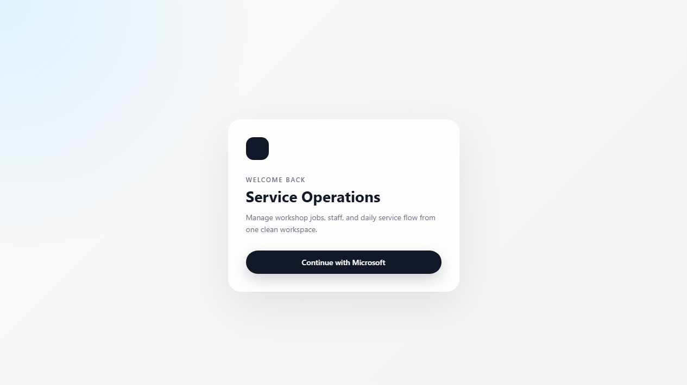

# Getting started and signing in

Service Operations is Liftrucks' workspace for managing operational records. Your work account
determines which parts of the app you can open and which actions you can perform.

The Job Book migration beginning **Wednesday 21 October 2026** applies to Auckland only. Other
branches continue using their existing Job Book processes until a separate change is announced.

## Before you begin

You need:

- your individual Liftrucks Microsoft work account;
- access assigned by the Service Operations administrator; and
- a current web browser such as Microsoft Edge or Google Chrome.

Do not share an account. Each person signs in separately so changes can be traced to the correct user.

## Open Service Operations

Open:

**[https://kind-wave-0cdea2200.2.azurestaticapps.net](https://kind-wave-0cdea2200.2.azurestaticapps.net)**

Bookmark this address after confirming that the Service Operations sign-in page has opened.

## Sign in

1. Select **Continue with Microsoft**.
2. Choose your Liftrucks work account. If it is not shown, select **Use another account** and enter
   your work email address.
3. Complete Microsoft's sign-in or verification prompt.
4. Wait for Service Operations to open. Do not repeatedly select the sign-in button while the page
   is returning from Microsoft.
5. Check the name shown at the bottom of the left menu to make sure the correct account is active.

## Check that the correct role opened

A **Job Book Admin** normally lands on **Job Book** and sees:

- **Job Book**
- **Equipment**
- **Customers**

An **Office Admin** normally lands on **Job Card reviews** and also sees:

- **Job Book**
- **Quotes**
- **Equipment**
- **Customers**

Office Admin is the user-facing name for the Job Card Admin access profile. Seeing fewer options may
mean the older access claim is still cached. Seeing screens outside your assigned role should be
reported before continuing.

## Move around the app

Use the menu on the left to change screens. Select the small arrow near the top of the menu to make
it narrower or wider. On a smaller screen, selecting a menu item closes the menu automatically.

Most lists provide search, filters or tabs. Selecting a row or **Edit entry** usually opens a panel
from the right. Use the action button at the bottom of that panel to save, or **Cancel** to leave
without saving.

## If Microsoft asks you to reconnect

If your session expires, the app displays **Reconnect to continue**.

1. Select **Reconnect Microsoft** once.
2. Complete the Microsoft prompt using the same work account.
3. Return to the app. Your current page stays open and the interrupted request continues.

Do not open a second copy of the record while reconnection is in progress.

## If the wrong account or access appears

1. Stop before changing any records.
2. Check the name at the bottom of the left menu.
3. Close all Service Operations tabs, then open the site again.
4. If the old role is still shown after an access change, sign out of Microsoft in that browser and
   sign in again, or use a private browser window for the first fresh sign-in.
5. If the problem remains, send the administrator your work email address and the exact message on
   screen. Never send your password or verification code.

### Common access messages

| Message | Meaning | What to do |
| --- | --- | --- |
| **Access has not been assigned** | Microsoft sign-in succeeded, but the account has no Service Operations app role. | Contact the administrator and provide your work email address. |
| **This area is not available** | The link opened a screen outside your assigned role. | Use the left menu to return to an available screen. |
| **Reconnect to continue** | The Microsoft session used for Dataverse has expired. | Select **Reconnect Microsoft** once and complete sign-in. |
| A page keeps showing **Loading** or a load warning | The app or data service may be temporarily unavailable. | Wait briefly, use the on-screen retry once, then report the message if it continues. |

## Reporting a problem

Report issues as soon as possible and include:

- what you were trying to do;
- what happened instead;
- the Job Number, when applicable; and
- a screenshot of the affected area.

On Windows, hold **Windows key + Shift + S**, select the area, then paste the screenshot into your
email. Do not include passwords, verification codes or unnecessary customer-sensitive information.

Next: [Auckland Job Book migration](Auckland-Job-Book-Migration) · [Job Book Admin guide](Job-Book-Admin-Guide) · [Office Admin guide](Office-Admin-Guide) · [Customers, Sites and Contacts](Customers-Sites-and-Contacts)

_Last reviewed: 21 October 2026._
